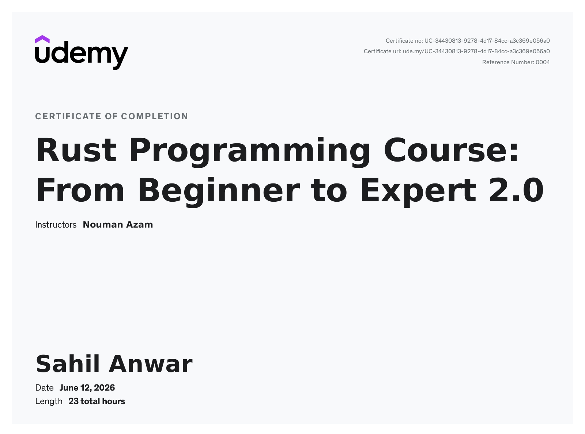

# Rust Programming — Advanced Programming Practice 🦀

A topic-wise collection of Rust exercises, learning notes, and source files from my **Advanced Programming** semester course.



## About this repository

During my last semester, I studied Rust programming and worked through introductory concepts, ownership and borrowing, and more advanced language features. This repository keeps my original class exercises and adds a structured set of extra practice examples for revision.

- **107 additional self-contained practice examples** in `practice/` (organized for this repository)
- **35 original Rust source files** preserved from my uploaded Advanced Programming archive in `semester_originals/`
- Source files are separated by topic, and each example contains its own `main()` function.

> **Provenance:** `semester_originals/` contains source files from my semester archive. `practice/` contains supplementary examples prepared while organizing this repository; these should not be confused with the original semester submissions. Some original files may be partial exercises or contain errors.

## Topics

| Folder | Focus |
| --- | --- |
| [`practice/01_basics/`](practice/01_basics/) | Basics |
| [`practice/02_variables_types/`](practice/02_variables_types/) | Variables Types |
| [`practice/03_operators/`](practice/03_operators/) | Operators |
| [`practice/04_conditions/`](practice/04_conditions/) | Conditions |
| [`practice/05_loops/`](practice/05_loops/) | Loops |
| [`practice/06_functions/`](practice/06_functions/) | Functions |
| [`practice/07_strings/`](practice/07_strings/) | Strings |
| [`practice/08_arrays_vectors/`](practice/08_arrays_vectors/) | Arrays Vectors |
| [`practice/09_tuples_structs_enums/`](practice/09_tuples_structs_enums/) | Tuples Structs Enums |
| [`practice/10_ownership_borrowing/`](practice/10_ownership_borrowing/) | Ownership Borrowing |
| [`practice/11_collections/`](practice/11_collections/) | Collections |
| [`practice/12_options_results/`](practice/12_options_results/) | Options Results |
| [`practice/13_traits_generics/`](practice/13_traits_generics/) | Traits Generics |
| [`practice/14_iterators_closures/`](practice/14_iterators_closures/) | Iterators Closures |
| [`practice/15_files_modules_tests/`](practice/15_files_modules_tests/) | Files Modules Tests |


## Running an example

Install Rust from [rustup.rs](https://rustup.rs/). From the repository root:

```bash
rustc practice/01_basics/01_intro_hello.rs -o hello
./hello
```

On Windows, run `hello.exe` instead of `./hello`. Each file is a standalone program; compile one at a time. The generated executable is ignored by Git when it has the `.exe` extension, but on Linux/macOS use an output directory outside the repository or remove the executable after running.

## Original semester work

The `semester_originals/` folder retains the source files and their original names and relative paths from `AP.zip`. Compiled binaries, nested Git metadata, and unrelated large assets from the archive were not copied into this clean source repository.

## Learning notes

- Ownership and borrowing take practice; compiler errors can be useful feedback.
- Start with variables, conditions and loops, then work toward functions, collections and error handling.
- For debugging, read the first compiler error carefully before making changes.

## Certificate

**Rust Programming Course: From Beginner to Expert 2.0**  
Instructor: **Nouman Azam**  
Platform: **Udemy**  
Completed: **June 12, 2026**  
Course length: **23 total hours**  
[View certificate](assets/rust-course-certificate.jpg)

## Acknowledgment

A big thank you to **Nouman Azam** for his clear explanations and guidance throughout the Rust programming course. His teaching helped me understand Rust fundamentals and encouraged me to keep practicing beyond the classroom.

## Notes

This repository is intended for learning and reference, not as a production software library. The supplementary examples are intentionally small so they can be read and tested independently.

---
**Sahil Anwar** · Advanced Programming · Rust Practice

## Original semester work

The original course exercises are grouped by subject in [`semester_originals/`](semester_originals/README.md). Their Rust code is unchanged; only directory names and grouping were cleaned up.
